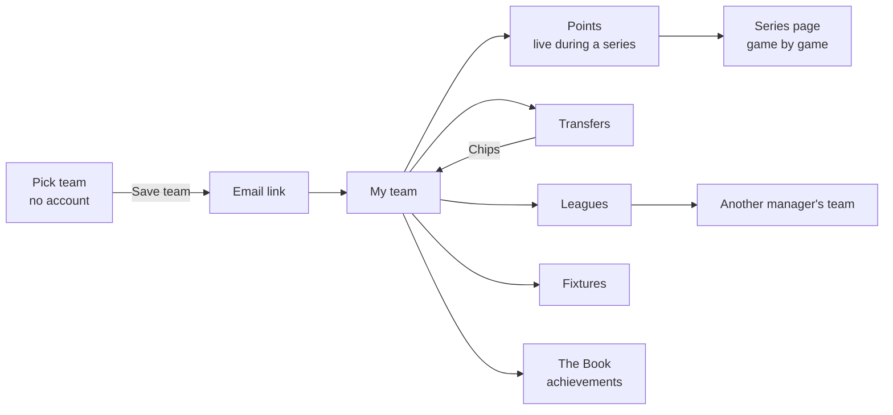

# Site flow: a proposal

The site map as a picture: [site-map.png](site-map.png) (source `site-map.html`). The front door is
Pick team: onboarding copies UCL Fantasy, a page where you can just pick a team (Craig, 11 Nov 2026).

How a visitor moves through the site. Claude's proposal from Craig's outline in
[SPEC.md](../../SPEC.md); each screen is settled by its own `/grill` and picture before it is built.

## The screens

| Screen | Its job | FPL's equivalent |
|---|---|---|
| Pick team (signed out) | The front door. Build a squad inside the budget with no account, then save. | Squad selection, but before sign-up, as UCL Fantasy does |
| Email link | One field. The squad built signed out becomes the manager's team. | Register |
| My team | Set the lineup, captain and bench before the deadline. Play a chip. | Pick Team |
| Points | This gameweek's points, moving live, with each player's breakdown. | Points |
| Series page | One series, game by game: who scored what and why. | Match pop-up |
| Transfers | Swap players inside the budget; see the −4 before confirming. | Transfers |
| Leagues | The global table, the supporter league, private leagues with a join code. | Leagues & Cups |
| Another manager's team | A rival's lineup and points, after the deadline. | Entry view |
| Fixtures | The LCK's week: series, times in the visitor's time zone, results. | Fixtures |
| The Book | The achievement book: pages earned, pages still blank, the story behind each. | none |

## The first pictures

[proposals/2026-11-11-pick-team/](proposals/2026-11-11-pick-team/) holds three looks for Pick
team, drawn to look nothing alike so Craig can choose a direction:

- **A, The Rift** (`a-rift.html`): the squad sits on the map by lane, as FPL's sits on a pitch.
- **B, Five colours** (`b-obangsaek.html`): a light team sheet, one traditional Korean colour per role.
- **C, Sports daily** (`c-sports-daily.html`): a Korean sports paper's front page, loud and dense.

Players, prices, squad size and the bench in them are examples, not decisions. The look Craig
picks becomes `docs/design/plate.md`, the rules every later screen follows.
