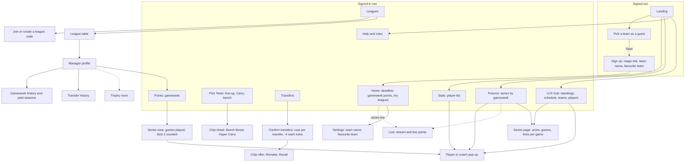

# FPL sets the page list; others trim it

Every season-long fantasy game surveyed has the same small core: a team page where you set the line-up and captain, a transfers (or market) page, leagues with an automatic global league plus private and favourite-team leagues, a points view, and a rules page. FPL goes much further than the rest. Its points, history and transfer-history pages are public for any manager by ID, and it adds a full player stats table, a player popup, fixtures with difficulty ratings, a team of the week and, from 2026/27, a price-change page. No other game was seen to match that depth, and Riot's own LoL fantasy (LTA Fantasy, 2025) names only five pages. For Flol this means FPL's page set is the right template, and Flol's own spec adds three things no surveyed game has shown: a coach slot that is a team, points per series from the best 2 games, and an achievement book. The evidence is uneven. FPL's public pages were read live on 13 Nov 2026, but its signed-in screens (Pick Team, Transfers, chip confirmations) were not seen. Every other game's pages come from rules text, launch articles and guides, not screens. UCL Fantasy's "pick a team before sign-up" flow, which Flol's onboarding copies, was confirmed on the live site; no written source described it.

**Contents:** [Pages per site](#pages-per-site-two-tables-twelve-games) · [Common core](#five-pages-every-game-has-and-five-only-fpl-has) · [What's unusual](#the-unusual-ideas-sit-in-leagues-chips-and-comparison) · [Research gaps](#three-gaps-for-flol-one-now-closed) · [Flol's page list](#flol-needs-about-twenty-pages-most-backed-by-fpl) · [Site flow](#flols-site-flow-proposed) · [Open questions for Craig](#open-questions-for-craig) · [Conclusion](#conclusion)

Researched 13 Nov 2026. The notes behind this report are in [docs/research/fantasy-site-pages/](fantasy-site-pages/). This is background research, not the product: Flol's rules are in `SPEC.md` and `spec/`.

## Pages per site: two tables, twelve games

Key to both tables: **seen** means read on the live site; **named** means a rules page, help text or article names the page or describes it; **none found** means no source mentioned it, which is not proof it is absent.

### Football and other sports

| Page | FPL | UCL Fantasy | F1 Fantasy | AFL Classic | Bundesliga | ESPN | Six Nations |
|---|---|---|---|---|---|---|---|
| Home / status | Seen signed out (sign-up pitch); signed-in Status page unconfirmed | none found | none found | none found | none found | Named: personalised Home | none found |
| Pick team | Named: Pick Team | Named: My Team | Named: lineup page | Named: My Team | Named (autosave, no save button) | Named: Roster | Named (captain, supersub) |
| Transfers | Named: Transfers, with flow | Named in rules | Named | Named: trades | Named | Players (add/drop) | Named in old guides |
| Chips: activation and confirm | Named: where each chip is played; screens not seen | Named: activate, confirm, save | Named: 6 chips, final once played | none found | No chips (star players) | n/a (draft game) | None confirmed |
| Points / gameweek view | Seen, public by ID | none found | none found | Named: match-ups | none found | Named: Matchup | none found |
| Team history (gameweek and season) | Seen: Entry History | none found | none found | Named: league history | none found | none found | none found |
| Transfer history | Seen | none found | none found | Named | none found | none found | none found |
| Player stats list | Seen: Statistics | none found | none found | Named: Stats Centre | none found | none found | none found |
| Player detail popup | Seen | none found | none found | none found | none found | Named: Player Cards | none found |
| Fixtures | Seen, with FDR tab | none found | none found | none found | none found | none found | none found |
| Leagues | Seen (standings); create/join not seen | Named | Named | Named | Named | Named | Named (supporter leagues) |
| Other managers' teams | Seen, public by ID | none found | none found | Named: Foes | none found | Matchup swipes | none found |
| Cup | Seen (URL, not started) | none found | none found | none found | H2H knockout mode | none found | none found |
| Prizes | Seen | Named in guides | Named | none found | none found | none found | none found |
| Help / rules | Seen: Help, Rules, FAQs, T&Cs, New | Rules article, email support | Rules page (would not load) | Off-site Fantasy Hub | Article | none found | Article |
| Sign-up / onboarding | Register first; guided squad picker (2026/27) | Register first, in every source | Survey at registration places you in leagues | AFL iD | Random starting squad | none found | none found |
| Settings | On premierleague.com; not found | Country of residence named | none found | none found | none found | none found | none found |
| Extra public pages | Team of the Week, Price Changes, The Scout | none found | none found | none found | none found | none found | none found |
| App-only | None found | Notifications in app | None found | Web first, app a week later | Whole game app-only | "Find a Bet" icon | None found |

FPL's facts come from its live site ([FPL entry page](https://fantasy.premierleague.com/en/entry/1/event/10); [FPL Statistics](https://fantasy.premierleague.com/en/statistics); [FPL Rules](https://fantasy.premierleague.com/en/help/rules)). UCL's come from UEFA's 2026/27 rules article ([UEFA rules](https://www.uefa.com/uefachampionsleague/news/025f-0fd4b42cc0a7-74498b7df63b-1000/)). F1's come from its launch article and guides ([Formula1.com](https://www.formula1.com/en/latest/article/boost-the-fun-with-friends-and-family-this-season-f1-fantasy-is-back.2xVBBN90riZiaYXeYhOe0Z); [Motorsport Magazine](https://www.motorsportmagazine.com/articles/single-seaters/f1/f1-fantasy-chips-what-they-are-and-when-to-use-them/)). AFL's ([AFL.com.au](https://www.afl.com.au/news/1460108/afl-fantasy-classic-2026-bigger-better-and-worth-the-wait)), Bundesliga's ([Bundesliga.com](https://www.bundesliga.com/en/bundesliga/news/official-fantasy-manager-2025-26-everything-you-need-to-know-32987)), ESPN's ([ESPN Press Room](http://espnpressroom.com/press-release/espn-fantasy-football-30th-anniversary-new-design-new-features-all-new-fantasy-app-for-2025/)) and Six Nations' ([IRFU](https://www.irishrugby.ie/2026/01/29/six-nations-fantasy-rugby-is-back/)) come from official articles.

### LoL and esports

| Page | LTA Fantasy (Riot, 2025) | Fantasy LCS (Riot, 2014–18) | HLTV Fantasy (CS2) | VCT Pick'Em | SOOP LCK fan games |
|---|---|---|---|---|---|
| Home / status | Named: Dream Team and top scores of the week | none found | none found | none found | Event page |
| Pick team | Named: My Team | Draft roster | Per-event lineup | n/a (predictions) | n/a (predictions) |
| Transfers | Named: Market, with "Sell All Players" | Draft and trades (unconfirmed) | none found | n/a | n/a |
| Chips | None named | none found | Boosters, per match | n/a | n/a |
| Points view | Weekend average per player; no screen found | none found | Per match | Bracket score | Prediction score |
| Game-by-game series view | **none found** | none found | none found | n/a | n/a |
| Leagues | Named: up to 13, friends, streamers | Draft leagues | none found | Faction leaderboard | Fan count per team |
| Help / rules | Rules page (would not load) | FAQ | Rules page (would not load) | Guides | none found |
| Sign-up | Riot ID, then team name, logo, tricode | none found | none found | none found | Missions: sign up, pick a favourite team |
| Settings | Favourite team, changeable once a stage | none found | none found | none found | none found |
| App-only | None: web on mobile or PC | n/a | none found | none found | Gems, stream rewards |

LTA's page names come from Riot's own FAQ and its Split 3 notes ([Riot support](https://support.riotgames.com/en-us/league-of-legends/events/lta-fantasy-faq); [lolesports.com](https://lolesports.com/en-US/news/fantasy)). Fantasy LCS closed after Riot said its users had fallen by over 90% ([win.gg](https://win.gg/news/1331/fantasy-lcs-and-lec-postponed-beyond-the-2019-summer-split)). HLTV's format is from [pley.gg](https://pley.gg/cs2/hltv-fantasy-season-kicks-off-with-blast-bounty-finals/), VCT's factions from [valorantesports.com](https://valorantesports.com/en-US/pickems/113482263742879102/factions/leaderboard), and SOOP's LCK games from Korean press ([Dailian](https://www.dailian.co.kr/news/view/1543367/); [Smart Today](https://www.smarttoday.co.kr/ko-kr/articles/100792)). **No LCK season-long fantasy game was found.**

### How the top navigation groups pages

Only FPL's signed-out bar was seen. It has eight items: **Home, Prizes, The Scout, Price Changes, Injuries, Podcast, Help and Statistics**, under a switcher for FPL Challenge and FPL Draft ([FPL home](https://fantasy.premierleague.com/en/)). Leagues sends a signed-out visitor to the register pitch, so it is a signed-in page ([FPL leagues URL](https://fantasy.premierleague.com/en/leagues)). The FAQ names signed-in tabs called Points, Pick Team and Transfers ([FPL FAQs](https://fantasy.premierleague.com/en/help/faqs)). From the pages seen, FPL falls into three groups: **my team** (Points, Pick Team, Transfers, Leagues & Cups), **public game data** (Statistics, Fixtures, Price Changes, Team of the Week, any manager's pages), and **content and help** (The Scout, Podcast, Injuries, Prizes, Help). A manager sidebar with ranks, leagues, cups, transfers and finance sits on every entry page, so it is one shared panel, not a page. No other game's nav bar was found in any source. UCL and Bundesliga sit inside larger club or competition apps, and AFL and F1 put advice off the game, on a hub or news site.

### Which features are app-only

Only one game is app-only: **Bundesliga Fantasy runs only in the Bundesliga app** ([Bundesliga.com](https://www.bundesliga.com/en/bundesliga/news/official-fantasy-manager-2025-26-everything-you-need-to-know-32987)). FPL is the reverse: its official text marks three things as web-only (the per-page help icon, guided squad selection and the career-average comparison), and it tells managers with app trouble near a deadline to use the website ([FPL FAQs](https://fantasy.premierleague.com/en/help/faqs); [PL: 2026/27 changes](https://www.premierleague.com/en/news/4679873/all-you-need-to-know-about-changes-to-fpl-for-202627)). UCL's rules point to the UEFA Gaming app for deadline notifications. LTA Fantasy has no app at all. Push notifications are the one recurring app extra, and no game lists them fully.

## Five pages every game has, and five only FPL has

The common core is **pick team (with captain or its stand-in), transfers or a market, leagues, a points view and a rules page**. Every budget game has them in some form. Leagues are the most alike: each game auto-enters a manager into an overall league and leagues by attribute, and lets him make private leagues by code. FPL has Overall, country, favourite club, start gameweek and Second Chance ([FPL Rules](https://fantasy.premierleague.com/en/help/rules)). UCL has overall, country and favourite club ([UEFA rules](https://www.uefa.com/uefachampionsleague/news/025f-0fd4b42cc0a7-74498b7df63b-1000/)). F1 has Global, Country, Constructor and Driver leagues ([Formula1.com](https://www.formula1.com/en/latest/article/boost-the-fun-with-friends-and-family-this-season-f1-fantasy-is-back.2xVBBN90riZiaYXeYhOe0Z)). A favourite-team pick feeding a supporter league is close to universal: Six Nations, LTA Fantasy and even SOOP's prediction games have one.

Chips are core in the FPL family but not everywhere. Where FPL plays them matters for Flol. **Bench Boost and Triple Captain are played on Pick Team when saving and can be cancelled before the deadline. Wildcard and Free Hit are played when confirming transfers and cannot be cancelled** ([FPL Rules](https://fantasy.premierleague.com/en/help/rules)). UCL's two chips use one flow: activate, confirm transfers, save; activating cancels that matchday's earlier transfers and their hits ([UEFA rules](https://www.uefa.com/uefachampionsleague/news/025f-0fd4b42cc0a7-74498b7df63b-1000/)). F1's chips are final once played ([Motorsport Magazine](https://www.motorsportmagazine.com/articles/single-seaters/f1/f1-fantasy-chips-what-they-are-and-when-to-use-them/)). FPL's FAQ implies chip buttons show states such as Unavailable, Active and Pending.

Five pages were found only in FPL, and all five are public by URL. **Entry History** lists each gameweek's overall rank, points, gameweek rank, bench points, transfers, hit cost and team value, then chips played and past seasons ([FPL entry history](https://fantasy.premierleague.com/en/entry/1/history)). **Transfer History** lists every transfer with its gameweek ([FPL entry transfers](https://fantasy.premierleague.com/en/entry/1/transfers)). **Statistics** is a sortable, filterable player table with about 40 sort options and a price cap filter ([FPL Statistics](https://fantasy.premierleague.com/en/statistics)). The **player popup** opens over any list with a stat strip, form and next fixtures, then History and Fixtures tabs. **Fixtures** has a difficulty tab ([FPL fixtures](https://fantasy.premierleague.com/en/fixtures)). Team of the Week and Price Changes complete the set. Other managers' teams work through these public pages: every league row links to that manager's Points view, and so does the "Highest Points" link. AFL gets a similar result through "Foes", which tracks any team's score without sharing a league ([AFL.com.au](https://www.afl.com.au/news/1460108/afl-fantasy-classic-2026-bigger-better-and-worth-the-wait)).

## The unusual ideas sit in leagues, chips and comparison

Most differences are in rules, not pages. UCL lets a manager make up to four subs and switch his captain between nights within a matchday, and any manual change turns off autosubs ([Fantasy Football Scout](https://www.fantasyfootballscout.co.uk/2025/09/17/ucl-fantasy-2025-26-how-to-make-subs-captain-changes)). F1 allows three teams per account, unlocks three chips only after the first race, and has one chip, Final Fix, played after the deadline ([Formula1.com](https://www.formula1.com/en/latest/article/boost-the-fun-with-friends-and-family-this-season-f1-fantasy-is-back.2xVBBN90riZiaYXeYhOe0Z); [Motorsport Magazine](https://www.motorsportmagazine.com/articles/single-seaters/f1/f1-fantasy-chips-what-they-are-and-when-to-use-them/)). Bundesliga gives each new manager a random squad, saves every change automatically, and scores the best 11 so there are no subs ([Bundesliga.com](https://www.bundesliga.com/en/bundesliga/news/official-fantasy-manager-2025-26-everything-you-need-to-know-32987)).

The ideas that become pages are about comparison. AFL compares a manager with the top 1%, 5%, 100 and 1000 each round, shows each traded-in player's score since joining, and marks past top-100 finishers with a hat icon, the only lasting badge found in any game ([AFL.com.au](https://www.afl.com.au/news/1460108/afl-fantasy-classic-2026-bigger-better-and-worth-the-wait)). ESPN's home is a dashboard of jobs by weekday ([ESPN Press Room](http://espnpressroom.com/press-release/espn-fantasy-football-30th-anniversary-new-design-new-features-all-new-fantasy-app-for-2025/)). FPL's 2026/27 additions point the same way: guided squad picking, career average against all managers, and live league tables ([PL: 2026/27 changes](https://www.premierleague.com/en/news/4679873/all-you-need-to-know-about-changes-to-fpl-for-202627)).

Esports games are thinner and stranger. **LTA Fantasy rebuilds the squad weekly from a 50-gold budget, so a Market replaces Transfers**, and it averages a player's matches over a weekend into one figure ([Riot support](https://support.riotgames.com/en-us/league-of-legends/events/lta-fantasy-faq)). Its Split 3 added a variety bonus for picking from more teams and +2 per game won against an opponent the manager picked ([lolesports.com](https://lolesports.com/en-US/news/fantasy)). Riot shipped league basics late: deleting, leaving and kicking were missing at launch. Fantasy LCS had the closest squad to Flol's, one player per role plus a flex and a team slot, but it was a draft game ([Inquirer Esports](https://esports.inquirer.net/?p=4276)). **No coach slot was found in any esports product.** VCT groups fans into team factions and ranks factions by the average of their top 75%, the nearest esports match to a supporter league ([valorantesports.com](https://valorantesports.com/en-US/pickems/113482263742879102/factions/leaderboard)). Korea's LCK fan games on SOOP are predictions and Player of the Match votes, with a favourite-team pick showing a live fan count per team and rewards tied to watching the broadcast ([Smart Today](https://www.smarttoday.co.kr/ko-kr/articles/100792)).

## Three gaps for Flol, one now closed

**FPL's signed-in screens were not seen.** Pick Team, Transfers, the confirm-transfers step, how a hit shows, and the Wildcard and Free Hit confirmation dialogs are known only from rules text and one official how-to ([PL: making transfers](https://www.premierleague.com/en/news/2174907/fpl-basics-making-transfers)). The signed-in nav bar, any "Status" home page, the create-league form, a started cup and account settings were not seen either. A memory of a pre-2025 Status page exists, but no source backs it. These are the screens Flol copies most closely, so a signed-in look at FPL should come before `/design` draws them. (Partly closed 14 Nov 2026: Pick Team, Points, Transfers, Leagues, a league table and Status were seen signed in, and Status exists; see [fpl.md](fantasy-site-pages/fpl.md#signed-in-seen-14-nov-2026). The confirm dialogs, the create-league form, a started cup and settings are still unseen.)

**UCL Fantasy's pick-before-sign-up flow is confirmed on the live site** (seen signed out, 13 Nov 2026, after Craig pointed to it). `gaming.uefa.com/en/uclfantasy` forwards to `/create-team`, a "Pick your squad" pitch beside the player list, with an Auto-fill button. A modal offers "Log in" or "I'll log in later", then "Try as a guest". Guests build a squad; on Continue a dialog says logging in is needed to update the team from any device, rejoin favourite leagues and see achievements unlocked. So UCL Fantasy has achievements too. The written sources all put sign-up first; the live site does not. `spec/09-onboarding.md` copies a flow that exists.

**No game-by-game series screen was found in any esports fantasy.** LTA averages a weekend into one number; HLTV scores per match, not per map ([pley.gg](https://pley.gg/cs2/hltv-fantasy-season-kicks-off-with-blast-bounty-finals/)). Flol scores a series from a player's best 2 games (`spec/05-scoring.md`), so a manager will want to see which games counted. Most weeks each team plays two Bo3 series (Craig, 13 Nov 2026; `docs/research/lck-2026-season-calendar.md`), so a player's gameweek is usually two series, each scored from its best 2 games: up to six games, four of them counting. There is no precedent to copy; it is a design question.

### FPL's signed-in app screens, from Craig's screenshots (13 Nov 2026)

Three screenshots from the Premier League app (2026/27, gameweek 11) close most of the first gap.

- **Transfers.** The header gives the gameweek and its deadline. Below it sit three figures (free transfers, points cost, money in the bank, the bank in green) and two chip cards, Wildcard and Free Hit, each showing its state ("Played in GW4"). A Pitch / List toggle and an Opponent picker sit above the pitch. The pitch shows all 15 players in rows by position, each with price, shirt, name and next opponent (home or away). A yellow name and a warning triangle flag a doubtful player; small icons mark others. The bottom bar has **Add Player** and **Next**, so confirming is a second step.
- **Pick Team.** The same header, then all four chips in a row (Bench Boost, Triple Captain, Wildcard, Free Hit), each with its state. Wildcard and Free Hit appear on both pages.
- **A chip's sheet.** Tapping a chip opens a bottom sheet: icon, name, what it does, and its limits. The Wildcard's says the first is lost after the gameweek 19 deadline and the second opens then; it cannot be cancelled once 2 or more transfers are made that gameweek; and once its status moves from "Pending" to "Active" it cannot be reversed. The sheet's button shows the chip's state.
- **The app's Fantasy home.** A switcher for Fantasy, Challenge and Draft at the top, then the manager's leagues with a rank and a green up or red down arrow each, grouped as invitational classic, invitational head-to-head, and general leagues. General leagues include Overall, the country, the favourite club, the start gameweek, Second Chance, a sponsor's badge league and a league for last season's top 10%. News and tips follow. The app's own tab bar is Latest, Fantasy, Season, Explore and More, with a shortcut rail (profile, an AI assistant called PL Companion, Following, Matches); the assistant's button also sits on Pick Team and Transfers.

Image search (Bing, 13 Nov 2026) filled more, from guides' screenshots of the web game:

- **Confirm Transfers** (web, 2022/23, [Fantasy Football Bible](https://fantasyfootballbible.co.uk/wp-content/uploads/2022/10/image.png)). A modal lists each transfer as Out, In and Cost (0 pts for a free one, 4 pts for each extra), then the total cost. A banner says which gameweek the transfers take effect for, with its deadline, and that they "will deduct 4pts from your score". In the same banner it offers the chip that would avoid the cost ("Play your Free Hit to make unlimited free transfers…") with its own button. The main button carries the cost: "Confirm Transfers (-4pts)".
- **Signed-in web nav** (2022/23, [Sporf](https://www.sporf.com/wp-content/uploads/2022/07/e6d423c2-screenshot-2022-07-07-at-17.05.54.png)): Home, Pick Team, Transfers, Leagues & Cups, Fixtures, The Scout, Podcast, Stats, Prizes.
- **Join a league.** "Choose a League Type to Join": up to 25 invitational and 5 public leagues. Invitational needs a league code; public puts you with "a small, randomly selected group of other game players".
- **Create a league.** One form: league name (30 characters at most, with a warning that offensive names can get the account deleted), which gameweek scoring starts from, and a "Create league cup" tick box with a "How the cup works" note (cups start in the second half of the season and end in gameweek 38). A league's own page then offers Standings, Administer and Invite Friends.

Still not seen: a started cup, settings, and the UCL achievements list (image search found only the returning-player badge: "last season you finished in the top 1%… Can you match it this season?").

Smaller gaps: no other game's nav bar was found; UCL's points, stats, fixtures and history pages were not found; LTA's player card, points page and roster slots could not be read (rules page refused fetches); and no game listed its push notifications.

## Flol needs about twenty pages, most backed by FPL

Flol copies FPL's structure (`SPEC.md`), so FPL's page set is the starting list. Each row below names the spec feature it serves and its backing. **FPL** means FPL has the page and the spec settles what it needs. **Craig** means the spec is silent on something the page needs, and the question is listed below. The user's named must-haves are marked ★. Every page still needs its picture through `/design` before it is built (`CLAUDE.md`).

| # | Page | What it holds, from the spec | Spec feature | Backing |
|---|---|---|---|---|
| 1 | Pick a team (first page, signed out) | Build a squad with no sign-up wall | 09 Onboarding | UCL (seen); Craig: Q1, Q2 |
| 2 | Sign-up | Account after the squad is picked | 09 Onboarding | Craig: Q1, Q3 |
| 3 | Home / status | The manager's start page | none | Craig: Q4 |
| 4 | Pick Team | 7 starters (5 roles, flex, coach), bench 1 and 2, Carry and Vice-carry from the six players, never the coach; Bench Boost and Hyper Carry played here, as FPL | 01 Squad, 04 Carry, 06 Chips | FPL |
| 5 ★ | Transfers | Player list beside the squad; prices in 억 with the note "1억 = 100 million won, game money only"; one free a week, bank to 3, −4 each extra; coach swap counts; unlimited before the first deadline; cap per team; Remake and Recall played on confirming, as FPL | 02 Prices, 03 Transfers, 06 Chips | FPL |
| 6 ★ | Chip confirmations | One chip a gameweek; states such as unavailable, active, pending; which stages allow it | 06 Chips, 10 Season | FPL for the flow; Craig: Q5 |
| 7 | Points (gameweek view, any manager) | Squad with points; usually two series a player, each from its best 2 games, with the games that counted shown; provisional during a series, final 3 hours after; Carry ×1.5 rounded down; auto-subs shown | 05 Scoring, 11 Live, 01 Squad | FPL; Craig: Q6 |
| 8 ★ | Team profile: gameweek history | FPL's Entry History: per gameweek rank, points, bench points, transfers, hits, team value; chips played | 03, 06, 08 | FPL; Craig: Q7 |
| 9 | Transfer history | Every transfer with its gameweek | 03 Transfers | FPL |
| 10 ★ | Other managers' teams | Pages 7–9 opened for any manager from a league row | 08 Leagues | FPL; Craig: Q8 |
| 11 ★ | Stats (player list) | Sortable list of players and coaches by the scoring lines, price, ownership; filter by role and team | 05 Scoring, 02 Prices | FPL; Craig: Q9 |
| 12 ★ | Player detail popup | Price, points, recent and next series; per-series history | 05 Scoring, 10 Season | FPL; Craig: Q10 |
| 13 | Coach detail popup | The team's lines, shown as its head coach | 01 Squad, 05 Scoring | Craig: Q11 |
| 14 | Fixtures | Series per gameweek, Bo3 or Bo5; deadline 15 minutes before the first series, in local time | 10 Season | FPL; Craig: Q12 |
| 15 ★ | Leagues: my leagues, create, join | Global leagues and team supporter leagues | 08 Leagues (to grill) | FPL; Craig: Q13 |
| 16 ★ | League standings | Ranks move per series when final; Split 1 leaderboard includes Road to MSI | 08, 10, 11 | FPL; Craig: Q14 |
| 17 | ~~Cup~~ | Not for now: a cup is head-to-head, and Flol sticks to points (Craig, 13 Nov 2026) | none | Answered: Q15 |
| 18 | Achievement book | Achievements worth about 1 point, LCK memes and history | 07 Achievements (to grill) | Craig: Q16 |
| 18b | Trophy room (on the manager profile) | Craig's idea (13 Nov 2026, talk, not spec): a manager's big achievements, such as season finishes. Not the points achievements of row 18, which would need their own name if ever built and are not a focus now | 08 Leagues; profile | Craig |
| 24 | LCK hub | Craig's idea (13 Nov 2026, talk): a section for the league itself: standings, schedule and results, teams and rosters, player pages. FPL leaves this to the Premier League app around it ("Season" tab); Flol has no such app, so it carries it | 10 Season; 01 Squad (coach is the team) | Craig |
| 25 | Series page | FPL's match page (Craig's screenshot, 13 Nov 2026): score, gameweek and date, tabs Match Details and Player Stats, links to each club's report, then goals, assists, cards, saves and bonus points split by side. For Flol: series score, each game's result, length and champions, and each player's lines per game with the best 2 marked | 05 Scoring, 10 Season | FPL; Craig |
| 19 | Price changes | Prices move once a week at the deadline | 02 Prices | Craig: Q17 |
| 20 | Team of the Week | Best squad of the gameweek | none | Craig: Q18 |
| 21 | Help: rules, FAQs, price formula | The price formula is public on a help page | 02 Prices, all | FPL |
| 22 | Settings / account | Team name, favourite team for the supporter league | 08, 09 | Craig: Q3 |
| 23 | Live | Craig's idea (13 Nov 2026, talk, not spec): the match stream embedded, with your squad's live points in a side panel; it pulses in the nav while a series is live and you're signed in, and Home may send you there | 11 Live points (for the points only) | Craig: Q20–Q23 |

FPL's Prizes page has no clear place: Flol has no cash prizes (`SPEC.md`, out of scope). That is Q19.

The Live page has no precedent in the survey. **No surveyed game was found to embed a stream**, though the research did not look for embeds as such. The nearest is FPL's fixtures panel, which links out to broadcasters under "Watch Live On" ([FPL entry page](https://fantasy.premierleague.com/en/entry/1/event/10)). SOOP ties its LCK rewards to watching on its own platform ([Dailian](https://www.dailian.co.kr/news/view/1543367/)). The page's points side is settled by `spec/11-live-points.md`, which was grilled on 13 Nov 2026: live points come from Riot's unofficial feed, shown as provisional, and turn final 3 hours after a series from Oracle's Elixir and Leaguepedia. GRID is out of scope. If the feed breaks, there are no live points, so the panel needs a state for that.

The nav could follow FPL's three groups: **my team** (Points, Pick Team, Transfers, Leagues), **game data** (Stats, Fixtures, and the rest of the public pages), and **help**. That is a proposal for `/design`, not a decision. The manager sidebar (ranks, leagues, transfers, money in the bank) should be one shared panel on pages 7–10, as in FPL.

## Flol's site flow, proposed

How the pages connect, from the survey and the spec (13 Nov 2026). Dashed lines are Craig's ideas, talk not spec. Signed out, a visitor picks a team as a guest and signs up to save it, as UCL Fantasy does; stats, fixtures and help stay public, as in FPL. Chips are played from the page they change: Bench Boost and Hyper Carry on Pick Team, Remake and Recall at the transfer confirm. Every league row opens that manager's profile, which holds their points, history, transfers and, if built, the trophy room. The source is also saved as [flol-site-flow.mmd](flol-site-flow.mmd).

### Craig's idea: fake Korean sponsors (13 Nov 2026, talk)

Flol has no sponsors, so the slots FPL sells (its sponsor's badge league, kit logos, the "presented by" line) could carry made-up Korean sponsors drawn from LCK memes and Korean culture: puns on players, the fries group, Faker and broccoli, as a love letter to the LCK. Two limits from earlier research apply: a fake sponsor must never use a real company's name, logo or look, and a joke about a real player must stay affectionate and avoid false claims (the research already ruled out the "Faker taxes" rumour). Riot's fan-project policy also asks for the line that Riot does not endorse or sponsor the project. Where the memes come from is in [achievement-memes.md](achievement-memes.md); the fries group is still unsourced.

## Open questions for Craig

These are where the spec is silent and a page cannot be drawn without an answer. Each waits for the grill of its feature. They are listed here once; the grills ask them five at a time.

| Q | Page | Question | Example |
|---|---|---|---|
| Q1 | 1, 2 | Closed: UCL's live site lets a guest pick first and asks for log-in to save, rejoin leagues and see achievements (seen 13 Nov 2026). Copy that? | Try as a guest, build the squad, press Continue, then the sign-up asks. |
| Q2 | 1 | Is a signed-out squad kept if the visitor leaves before signing up? | Close the tab, come back tomorrow: is the squad still there? |
| Q3 | 2, 22 | What does sign-up ask? Favourite team (for the supporter league), country, team name? Can the favourite team change later, and how often? | LTA allows one change per stage. |
| Q4 | 3 | What is the signed-in home: FPL's Points view, or a status page with deadline, free transfers and rank? | Open Flol on Thursday: what's first? |
| Q5 | 6 | Is the chip confirmation a separate dialog, and is Remake final once confirmed, as FPL's Wildcard is? | FPL: Wildcard can't be cancelled; Bench Boost can until the deadline. |
| Q6 | 7, 12 | How does a series show which 2 games counted? No esports fantasy shows a game-by-game view. | Faker scores 5, 2 and 4 in a Bo5: show all three and mark the 5 and 4? |
| Q7 | 8 | Does history group by split, since chips reset at the split? | A Split 1 and a Split 2 table, or one season table? |
| Q8 | 10 | Is every manager's team public, as in FPL? | Click a rival in a league: see his squad? |
| Q9 | 11 | Which columns does Stats show: every scoring line, or a short set? | Kills points, gold lead at 15, steals, first blood. |
| Q10 | 12 | What does the player popup show beyond FPL's: champions, KDA, the role he played on the day? | A stand-in mid who jungled one game. |
| Q11 | 13 | Does the coach get its own popup, with first tower, drakes, barons, elders, quick wins and the series result? | Gen.G's coach: 6.8 a series in the 2026 backtest. |
| Q12 | 14 | Does Fixtures show a difficulty rating, as FPL's FDR tab does? | T1 v BFX rated easy for T1. |
| Q13 | 15 | Which global leagues beyond Overall: country, supporter, start gameweek, Second Chance? Head-to-head leagues? Craig's no to a cup (points only, for now) suggests no head-to-head leagues either; confirm. | FPL has all of these; UCL no H2H. |
| Q14 | 16 | Does standings filter by split, as FPL filters by month? | Overall, Split 1, Split 2. |
| Q15 | 17 | Answered (Craig, 13 Nov 2026): no cup for now; a cup is head-to-head, and Flol sticks to points. | FPL makes a cup with each private league. |
| Q16 | 18 | Where do achievements show: their own page, on the team profile, or both? Is it a separate column in standings? (Already open in `docs/to-grill.md`.) | "Ryu sad face" unlocked in GW4. |
| Q17 | 19 | Is there a price-change page, and does it predict moves? | FPL added a predictor in 2026/27; Flol prices move once a week. |
| Q18 | 20 | Is there a Team of the Week? | Best 7 starters of GW5. |
| Q19 | none | Is there any non-cash reward or prize page? | LTA gave skins to its top 100. |
| Q20 | 23 | Which stream does Live embed: the LCK's official channel on YouTube, Twitch, SOOP or Chzzk? Whether each allows embedding is unchecked. | YouTube for overseas players, SOOP or Chzzk for Korea? |
| Q21 | 23 | When the feed is down, does the panel say so and wait for final points? (`spec/11`: no feed means no live points.) | Stream plays; panel reads "Live points unavailable". |
| Q22 | 3, 23 | Does Home send a signed-in manager to Live on its own, or show a banner? | T1 v Gen.G is on: redirect, or "Live now" bar? |
| Q23 | 23 | What does Live show when nothing is live? | Next series and its countdown, or last series' final points? |

## Conclusion

The surprise is how little the rest of the field adds to FPL's page set, and how much less Riot ships. LTA Fantasy launched with five pages and no way to leave a league, and Fantasy LCS lost over 90% of its users. FPL's depth is in public pages: history, transfers, stats and fixtures that anyone can open by ID. Those are exactly the must-haves named for Flol, so copying them is low risk.

Flol's real design work is in three places no surveyed game has solved: showing a series as best 2 games, giving the coach slot a face and a stat line, and fitting the achievement book into profiles and standings. The two checks to make before drawing screens are a signed-in walk through FPL's Pick Team, Transfers and chip dialogs, and a hands-on test of whether UCL Fantasy really lets a visitor pick before signing up.
